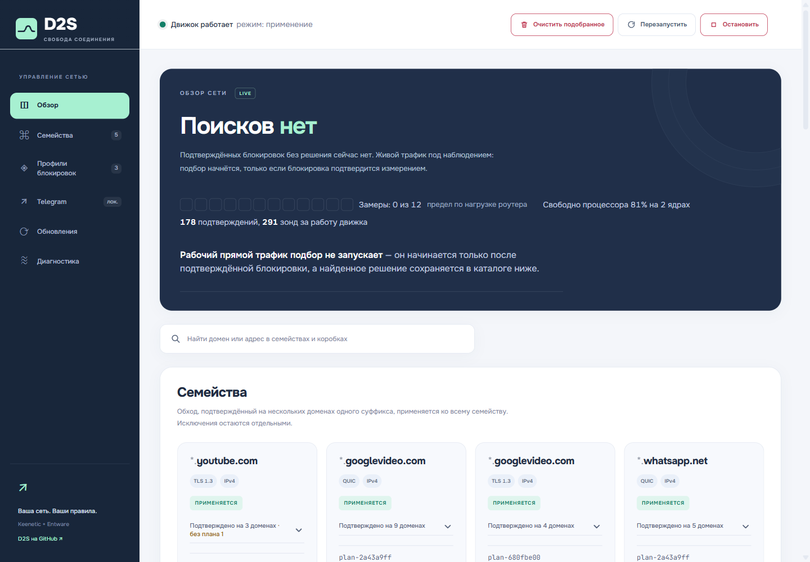

> Ветка 0.3 полностью переименована в D2S и пересобрана на t0fox/d2o `fd4e262`. Старый D2S сохранён в `archive/d2s-0.2.0`. Подробности: [аудит](docs/namespace-audit.md).

# D2S

**Обход DPI, Telegram и медиа WhatsApp для Keenetic / Netcraze с Entware.**

D2S — форк проектов **[necronicle/d2k](https://github.com/necronicle/d2k)** и **[t0fox/d2o](https://github.com/t0fox/d2o)**. Исходный движок и Telegram-прокси разработаны в этих проектах. D2S развивает их адаптацию для Keenetic / Netcraze, локальную обработку WhatsApp и собственный интерфейс; это самостоятельный выпуск, не официальный релиз исходных авторов. Подробнее: [происхождение и изменения](NOTICE.md).

D2S наблюдает соединения, проверяет подозрение на блокировку и подбирает стратегии. Telegram использует отдельный прозрачный MTProto/WSS-прокси. Для WhatsApp есть локальный резолвер и проверка медиадоменов — внешний VPS не требуется.

В 0.3.1 сокращены ожидания планировщика, добавлено время этапов поиска в
диагностику и отдельный кэш проверенных медиадоменов WhatsApp. Новые DNS-имена
запускают обработку по событию. [Что изменилось и как проверено](docs/field/2026-11-05-performance-stage1.md).

В 0.3.2 обновлены статусы и схема Telegram, скрыты коробки без целей
с сохранением планов и исправлено разделение HTTPS/MTProto.
[Панель и проверки](docs/field/2026-11-05-telegram-panel.md).
Telegram Web на проверенном маршруте всё ещё не открывается: сервер не
отвечает на TCP-подключение. [Подробности и границы исправления](docs/telegram-web.md).



## Быстрый старт

Нужны Entware, компонент KeeneticOS «Модули ядра подсистемы Netfilter» и SSH именно в Entware, обычно порт **222**. Выпускаются сборки **ARM64, ARMv7 и MIPSel**; архитектура определяется автоматически. Физически проверен KN-3811 с KeeneticOS 5.1.2 Preview. ARMv7 и MIPSel проходят запуск под QEMU, испытания на реальных роутерах ещё нужны.

Выполните одну строку под root:

```sh
opkg update && opkg install curl ca-bundle && curl -fsSL https://raw.githubusercontent.com/shurshick/D2S/main/install.sh -o /tmp/d2s-install.sh && sh /tmp/d2s-install.sh
```

Установщик поставит зависимости, проверит подпись Ed25519 и SHA-256 комплекта, выберет архитектуру и выведет адрес панели. Обычно это **http://адрес-роутера:8090/**. Панель доступна из LAN, не публикуйте её в интернет: аутентификация пока отсутствует.

Внутри ветки 0.3 обновляйте D2S через панель или `S99d2s update-install`:
настройки и найденные решения сохраняются, удалять установленную 0.3 не нужно.
Чистая установка требуется для перехода с ветки 0.2 или другого продукта:
сначала используйте его штатный деинсталлятор. Миграция старого каталога не
выполняется. Удалитель 0.2 доступен по [архивной ссылке](https://raw.githubusercontent.com/shurshick/D2S/d2s-v0.2.0/scripts/uninstall.sh);
он удаляет её конфигурацию и изученные стратегии. Не запускайте параллельно
другой DPI-движок для того же трафика. Для первого запуска сохраните настройки роутера.

## Что входит

- Основной движок на C и отдельный контроллер подбора.
- Современная веб-панель: состояние, стратегии, Telegram, журналы и обновления.
- Прозрачный Telegram — ручная настройка прокси в приложении не нужна.
- Локальный `/resolve`, доступный только самому роутеру.
- DNS-помощник WhatsApp: принадлежность адреса Meta и сертификат проверяются до изменения записей.
- Обнаружение медиадоменов по DNS-запросам LAN, включая случаи, когда TCP ещё не устанавливается.
- Восстановление правил после событий KeeneticOS и отдельный подписанный канал обновлений.

**Основной сетевой тракт сохраняет базу t0fox/d2o:** NFQUEUE, PPE, политики Keenetic и IPv4/IPv6. Для Telegram Web подготовлены [разделение TLS/MTProto и исключение собственных проверочных соединений](docs/telegram-web.md) из локального перехвата. LAN-перехват и диапазоны адресов не меняются. Определение private/protected используется только пассивным наблюдателем DNS WhatsApp. Проверка IPv6 на физическом стенде пока не проводилась.

## Автообновление

На новой установке включено по умолчанию. Проверка и начало установки выполняются один раз в сутки **с 02:00 до 03:59 по часовому поясу роутера**. В 04:00 новые автоматические установки не начинаются; уже начатая проверка здоровья/откат может завершиться позже.

```sh
/opt/etc/init.d/S99d2s update-check
/opt/etc/init.d/S99d2s update-install
/opt/etc/init.d/S99d2s update-auto-on
/opt/etc/init.d/S99d2s update-auto-off
```

Перед заменой создаётся резервная копия; после установки проверяется работа служб. При неудаче выполняется откат. Проверка подписи обязательна. Обновления не берутся из репозитория d2o.

## Управление

```sh
/opt/etc/init.d/S99d2s status
/opt/etc/init.d/S99d2s restart
/opt/etc/init.d/S99d2s stop
tail -n 50 /opt/d2s/log/d2sc.log
tail -n 50 /opt/d2s/log/whatsapp-media-dns.log
```

Основные настройки: `/opt/d2s/config`. Telegram: `TG_ENABLED=1`. Ночной канал: `AUTOUPDATE=1`. Для ограничения политикой Keenetic поддерживается `KEENETIC_POLICY` основного движка; Telegram использует штатные правила d2o.

Новое DNS-имя медиадомена запускает обработку сразу после наблюдения запроса
в LAN. Проверки сертификатов занимают дополнительное время. Периодический
проход раз в 30 секунд остаётся страховкой и подхватывает имена из журнала,
в том числе при DNS, зашифрованном самим приложением. Старый DNS-кэш
приложения может потребовать повторной попытки или перезапуска приложения.

## Удаление

Полное удаление служб, правил, настроек и найденных стратегий:

```sh
curl -fsSL https://raw.githubusercontent.com/shurshick/D2S/main/scripts/uninstall.sh -o /tmp/d2s-uninstall.sh && D2S_KEEP_STATE=0 sh /tmp/d2s-uninstall.sh
```

Удаление служб и правил с сохранением настроек и найденных стратегий в `/opt/d2s`:

```sh
curl -fsSL https://raw.githubusercontent.com/shurshick/D2S/main/scripts/uninstall.sh -o /tmp/d2s-uninstall.sh && D2S_KEEP_STATE=1 sh /tmp/d2s-uninstall.sh
```

Повторная установка D2S использует сохранённые настройки. Обе команды относятся к версии 0.3 и новее. Удаление остановится, если не удастся снять собственные DNS-записи; чужие записи не удаляются. keenetic-doq и общие пакеты Entware не удаляются.

### Удаление прежней ветки 0.2 перед чистой установкой

Используйте её собственный удалитель:

```sh
curl -fsSL https://raw.githubusercontent.com/shurshick/D2S/d2s-v0.2.0/scripts/uninstall.sh -o /tmp/d2s-remove-old.sh && sh /tmp/d2s-remove-old.sh
```

Эта команда полностью удаляет прежнюю установку вместе с её настройками. Затем выполните команду быстрого старта выше. Данные старой ветки в 0.3 не импортируются.

## Статус испытаний

На ARM64-стенде выполнена чистая установка 0.3 без переноса старого каталога. keenetic-doq сохранился и работает. Пользователь подтвердил YouTube, Telegram, WhatsApp и порядок карточек. Компоненты, правила, DNS и панель проверены отдельно. Удаление с сохранением настроек/стратегий и полное удаление проверены изолированными сценариями.

Это совместная проверка с keenetic-doq. Звонки, длительные сеансы, отдельный IPv6-тест приложений и физические ARMv7/MIPSel не считаются проверенными. Подробные результаты и границы аудита — в [аудите 0.3](docs/namespace-audit.md).

## Разработка и выпуск

Базовый код и история происхождения описаны в [NOTICE.md](NOTICE.md). Все внутренние службы, бинарники, рабочие пути и настройки используют пространство имён D2S; совместимость со старым каталогом не включена.

`scripts/build-router.sh` собирает исходный движок; `scripts/build-d2s-extras.sh` — локальный резолвер и DNS-наблюдатель. Подписанный выпуск запускается вручную через **Actions → D2S release**. Секрет `D2S_ED25519_PRIVATE_KEY` хранится только в GitHub Secrets; публичный ключ — в `docs/d2s-release-public.pem`.

Порядок проверок, кэширование и запуск следующего выпуска — в [инструкции CI и релизов](docs/ci-releases.md). Длинные тесты выполняются до публикации; выпуск использует успешный CI выбранного коммита.
